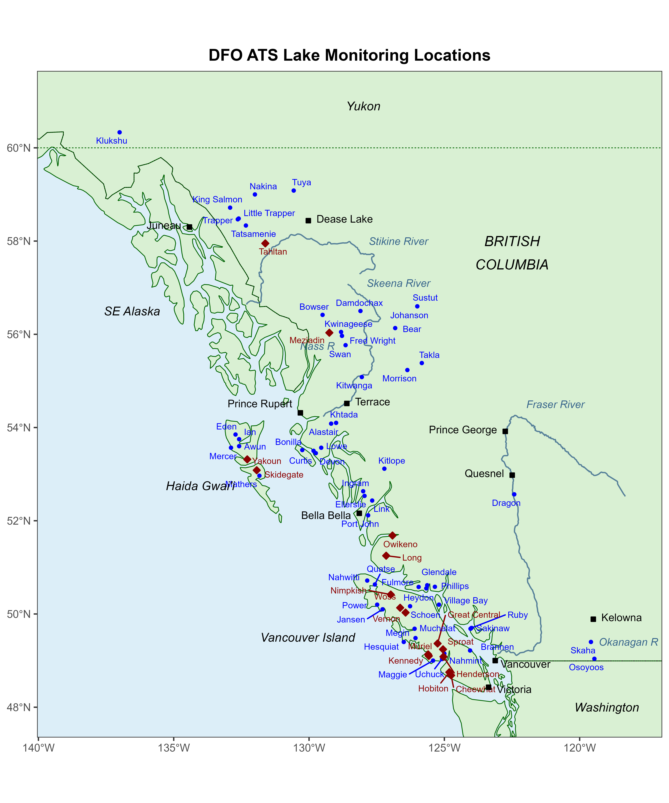
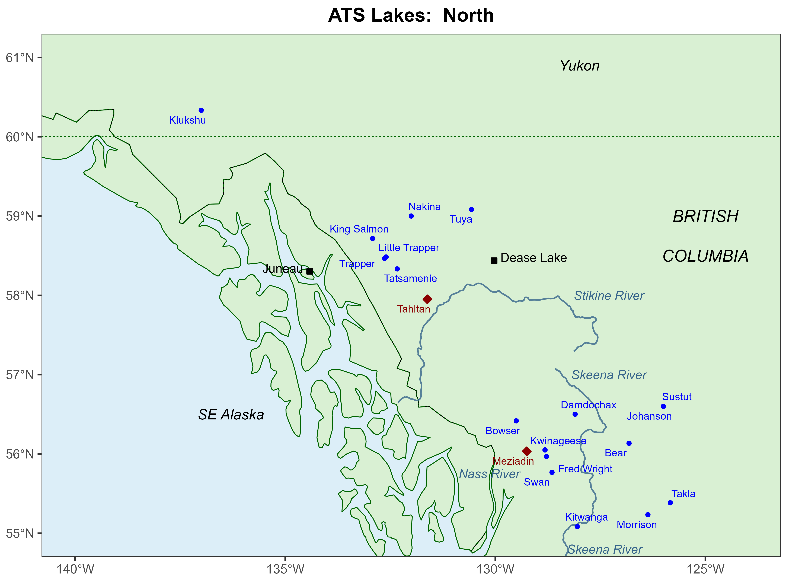
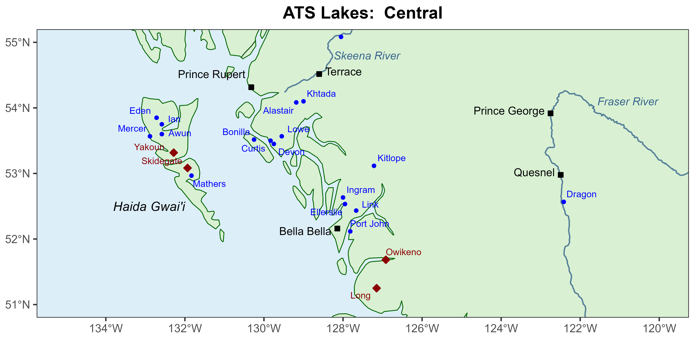
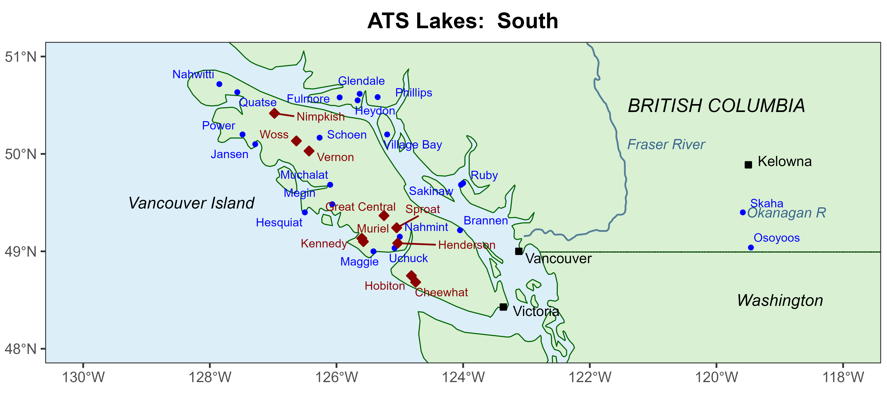
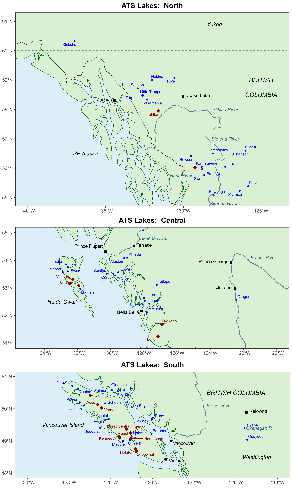
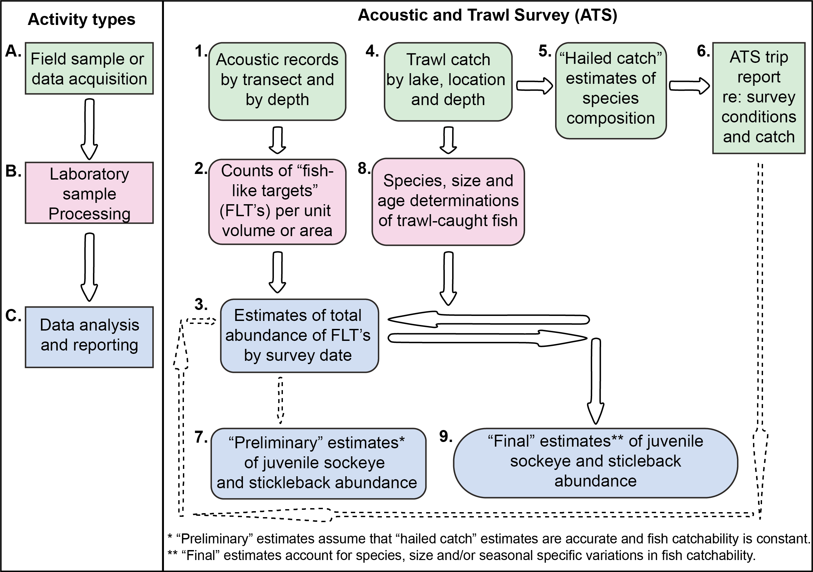

# 1. INTRODUCTION

The Department of Fisheries and Oceans Canada (DFO) and its predecessor[^01-introduction-1] conducted “lake enrichment” experiments from 1969 to 1975 in British Columbia (BC), Canada. These studies demonstrated that increasing the inorganic nutrients available in lakes would increase production in higher trophic levels [@hyattLakeEnrichmentProgram1984; @lebrasseurEnhancementSockeyeSalmon1978]. The Salmonid Enhancement Program (SEP) was established in 1977 as a joint initiative of the federal and British Columbia governments in response to the decline in spawning populations in the Northeast Pacific region [@greshEstimationHistoricCurrent2000][^01-introduction-2]. SEP funded the Lake Enrichment Program (LEP), starting in 1977, with the goal of enhancing juvenile Sockeye Salmon production in BC lakes, via the controlled experimental application of inorganic nutrient fertilizers and subsequent monitoring[^01-introduction-3] [@lebrasseurEnhancementSockeyeSalmon1978; @maclellanEvaluationMethodsUsed2010][^01-introduction-4].

[^01-introduction-1]: i.e., the Fisheries Research Board of Canada (FRB).

[^01-introduction-2]: While SEP subsequently evolved into an ongoing Fisheries and Oceans Canada program, it continues to operate through partnerships with Indigenous, provincial, community, and stewardship organizations.

[^01-introduction-3]: The DFO Lake Enrichment Program was largely phased out during federal budget reductions and organizational restructuring in the mid-1990s, though not because the technique proved ineffective. Retrospective reviews consistently concluded that lake fertilization was biologically effective and cost-efficient in specified locations, but LEP continuation required ongoing operational funding and long-term scientific support that became difficult to sustain under changing departmental priorities [@hyattResponsesSockeyeSalmon1985; @shortreedFactorsLimitingJuvenile2001; @hyattSockeyeSalmonOncorhynchus2004].

[^01-introduction-4]: The Salmon in Regional Ecosystems (SiRE) program and the Lakes Research Program (LRP), both within the Ecosystem Science Division of DFO, continued ATS (acoustic-trawl survey) studies after *19xx*. The LRP maintains a field program, primarily for **Fraser-basin lakes (?)**, while SiRE currently serves as a data-holder **[…as well as… ? how would we put it?—HS and AO to address this]**.

Throughout the program, the DFO field crews have collected comprehensive limnological and biological survey data. DFO conducted hydroacoustic surveys and trawl biosampling to estimate fish abundance of fish, especially Sockeye Salmon and Stickleback, in the freshwater bodies of BC [@hyattAcousticTrawlBased2000]. LEP’s Juvenile Salmon Index Data System (JSIDS) and its personnel served as DFO's primary mechanism for archiving, summarizing, and internal dissemination of juvenile salmon monitoring data, including information derived from acoustic-trawl surveys (ATS) and associated limnological studies during the 1980s – 2000s. Rather than a relational database, JSIDS was organized as a collection of ASCII (American Standard Code for Information Interchange) text files grouped by survey year and survey type (e.g., acoustic versus trawl). File formats were sufficiently standardized to allow for automated processing, compilation, and analysis across multiple projects and study lakes. As personal computers and spreadsheet software became more widely adopted during the 1990s and 2000s, portions of the original ASCII-based data holdings were converted into spreadsheet and other file formats. While these conversions improved accessibility for many users, they also reduced the consistency and traceability provided by the original system. In some cases, metadata, processing histories, file relationships, and data fields were not fully preserved, contributing to uncertainty regarding data completeness and provenance within these datasets.

## 1.1. Purpose of this Report

The objective of this report is to provide a consolidated description of the ATS archive, to document data sources and quality-control procedures, and to identify limitations and potential applications of these historical datasets.

In 2025, Fisheries and Oceans Canada partnered with the Canadian Institute of Ecology and Evolution (CIEE) Living Data Project (LDP) to rescue, standardize, and document historical ATS datasets collected through the Lake Enrichment Program and related monitoring activities. This report presents the resulting hydroacoustic dataset spanning 1977-2007, in combination with available trawl biosample data spanning 1977-1999, and documents the procedures used to recover, validate, and integrate these records.

Detailed procedures for recovery and consolidation of hydroacoustic data are presented separately in @zotero-item-913. This report incorporates available trawl biosample records to further document ATS dataset recovery, and pairs trawl records with acoustic surveys where available (1977-1999). Future data recovery initiatives will focus on assembly of missing trawl records (2000-2007), and incorporation of post-2007 ATS data from Salmon in Regional Ecosystems (SiRE) program archives.

Specifically, this report:

1.  Briefly introduces relevant historical sampling methods;
2.  Describes the recovered datasets and associated metadata;
3.  Documents data rescue, cleaning, and standardization procedures;
4.  Summarizes survey effort and historical field data;
5.  Identifies key data limitations and considerations for use; and
6.  Facilitates future ecological, limnological, and fisheries research.

## 1.2. Study Area of the Lake Enrichment Program

Acoustic-trawl surveys were conducted at 95 sites (including lake subdivisions) across a total of 77 lakes in British Columbia (Figures \@ref(fig:map-fig) and \@ref(fig:map-fig2)). since 1977. Most surveyed lakes were located in coastal watersheds and were characterized by low phosphorus concentrations, rapid water renewal due to high flows, and extreme oligotrophic conditions [@hyattResponsesSockeyeSalmon1985].

```{r map-fig, fig.cap="Lakes surveyed during the Lake Enrichment Program (LEP) in British Columbia. The 16 most surveyed lakes are represented as red diamonds. Other lakes are represented by blue dots, and place names by black squares", out.width = "100%"}



```

```{r map-fig2, fig.cap="Regional distribution of LEP-surveyed lakes in northern, central, and southern British Columbia.", out.width = "100%"}

#
#
#



```

## 1.3. Field Methods Background

ATS data acquisition and management steps are schematically represented in Figure \@ref(fig:schematic-fig), and documented in detail elsewhere [@lebrasseurEnhancementSockeyeSalmon1978; @hyattResponsesSockeyeSalmon1985; @gjernesPortableMidwaterTrawling1979; @robinsonSockeyeSalmonOncorhynchus1975; @hyattAcousticTrawlBased2000; @hyattSockeyeSalmonOncorhynchus2004; @simpsonFishSurveys151981; @shortreedFactorsLimitingJuvenile2001; @robinsonPopulationEstimatesSockeye1978; @hyattLakeEnrichmentProgram1984; @gjernesDevelopmentSpecificationsUse1986; @maclellanEvaluationMethodsUsed2010]

```{r schematic-fig, fig.cap="Flowchart showing the activity types (A-C) and sequential steps (1-9) performed to generate acoustic-trawl survey (ATS) estimates of limnetic fish abundance in the lakes of British Columbia. Modified from Hyatt et al. (2000).", out.width = "100%"}



```

### 1.3.1. Field Procedures

ATS field methods evolved through the 1970s and 1980s and are described in detail elsewhere (see beginning of section for review). Only a brief overview is provided here to support interpretation of the rescued datasets. Optimal techniques for fish population assessment vary depending on the characteristics of the lake, such as size, depth, and elevation.

### 1.3.2. *Acoustic Target Data*

Acoustic surveys were conducted at night using single-beam echosounders because Sockeye Salmon migrate to shallower depths during this time. From the 1970s to the early 1980s, Furuno systems were used [@robinsonPopulationEstimatesSockeye1978], and from 1984 onward, SIMRAD equipment was used [@gjernesDevelopmentSpecificationsUse1986]. Technical characteristics of echosounders limit their use in shallow waters, especially within the first meter of depth [@maclellanEvaluationMethodsUsed2010]. Each lake was surveyed using a series of echo-sounding transects, arranged such that the total linear distance surveyed was approximately proportional to lake area [@hyattResponsesSockeyeSalmon1985; @gjernesDevelopmentSpecificationsUse1986]. At least four acoustic transects were required per lake, and at least one acoustic transect per lake basin, when the basins were surveyed as sub-units of the lake [@RankinRutherford1985]. Fish abundance was estimated using echo trace counting of “fish-like targets” (FLT), standardized by sampled water volume [@gjernesDevelopmentSpecificationsUse1986].

### 1.3.3. *Trawl Biosample Data*

Trawl net sampling was used to collect fish specimens to identify species composition, to obtain biological measurements, and to calibrate hydroacoustic estimates according to the sizes of fish caught in the trawl [@robinsonSockeyeSalmonOncorhynchus1975]. Trawling also complemented hydroacoustic surveys by sampling parts of the water column where hydroacoustic targets were most numerous, as well as surface waters that were above the detection range of echosounders. Most surveys used a boat-towed 2 × 2 × 7.5 m midwater trawl. Although it did not occur in our rescued trawl records, variations of the net size were reported in other studies [*e.g.*, @robinsonSockeyeSalmonOncorhynchus1975]. Most fish specimens were preserved in formalin and measured at a later date. A small percentage of samples were preserved in ethanol. Due to the effects of preservatives on the specimens’ length and weight [@Shields1996EffectsOF], these measurements were taken several weeks to several months after collection. Standardized weight was calculated using provided formulas to account for differences in measurement timing and preservative type. Some fish were measured fresh and therefore required no conversion.