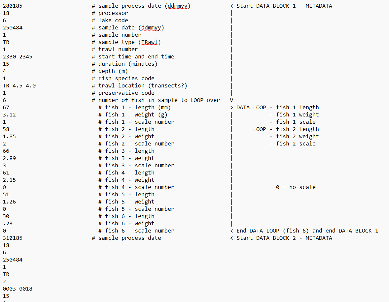
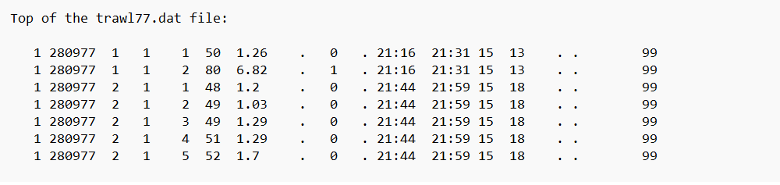
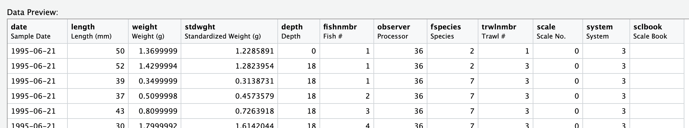
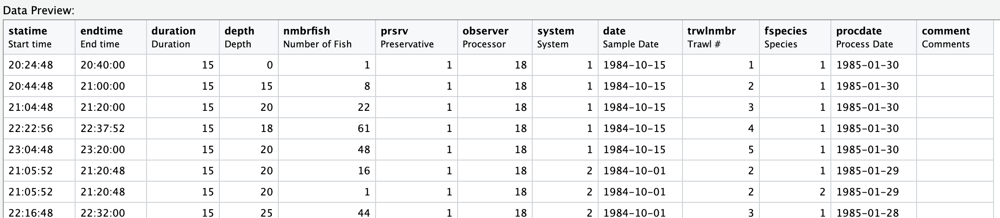
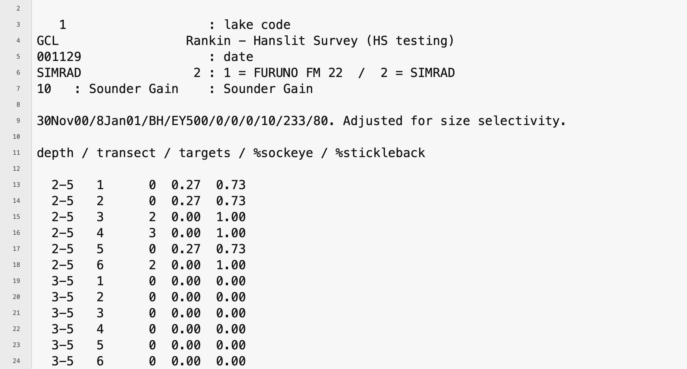

\newpage
# APPENDIX `r new_appendix()`. RAW DATA {#app:data-photo}

This appendix presents images illustrating the structure of the original raw acoustic DAT, as well as trawl DAT and SAS7BDAT files used in this project before being retrieved and converted into CSV files.

### Trawl DAT file

```{r dat-fig, fig.cap="Sample screenshot of an Apple computer DAT trawl file, with rows annotated for the first trawl survey in the file.", out.width = "100%"}



```

```{r sas-dat-fig, fig.cap="Sample screenshot of surviving 1977 to 1983 DAT files available only as tabular exports.", out.width = "100%"}



```

```{r sas-trawl-fig, fig.cap="Sample screenshot of an Trawlyy.sas7bdat file.", out.width = "100%"}



```

```{r sas-trawl-info, fig.cap="Sample screenshot of an Trlinfyy.sas7bdat file.", out.width = "100%"}



```

### Acoustic DAT file

```{r Acoustic-dat-fig, fig.cap="Sample screenshot of an Apple computer DAT acoustic file.", out.width = "100%"}



```

